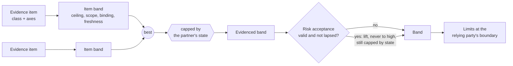
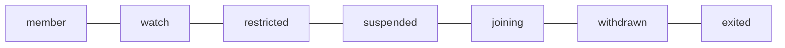

<div align="center">

# FTEF

**Federated Trust Evidence Framework**

*Trust between domains, earned by evidence, leased in time, cut by events.*

[](https://github.com/ftef-spec/spec/actions/workflows/check.yml)
[](https://github.com/ftef-spec/spec/actions/workflows/codeql.yml)
[](https://github.com/ftef-spec/spec/actions/workflows/fuzz.yml)
[](https://scorecard.dev/viewer/?uri=github.com/ftef-spec/spec)
<br>
[](spec/ftef.md)
[](01-community-specification-license-v1.md)
[](LICENSES/Apache-2.0.txt)
[](https://reuse.software/)

[Specification](spec/ftef.md) ·
[Schemas](schemas/0.1/) ·
[Examples](examples/) ·
[Decisions](decisions/) ·
[Roadmap](#status-and-roadmap) ·
[Contributing](CONTRIBUTING.md)

</div>

> [!WARNING]
> FTEF 0.1 is a **pre-draft**. Anything may change, including breaking changes to the schemas. Do not build
> production systems on it yet; do tell us what breaks when you try.

---

## Why FTEF

Domains federate: people, workloads and data cross from one administrative domain into another. Identity federation
tells a relying party *who* is on the other side. It does not tell it whether that side enforces what the relying party
needs, nor what to do when that changes.

Existing work grades evidence (audits, attestation), carries status (trust marks, status lists) and queries recognition
(trust registries). **FTEF binds them together**: a partner's evidence and its changes decide what the partner may do at
the relying party's boundary, under one contract that applies to every partner.

| Without FTEF | With FTEF |
|---|---|
| Trust is a yes/no list, reviewed once a year | Trust is a **band** (`none` < `low` < `medium` < `high`) recomputed from fresh evidence |
| An audit report counts as long as nobody looks | Evidence **ages**: stale lowers the band, long stale counts as missing |
| Exceptions accumulate silently | A **risk acceptance** is bounded: an end date, a reason, limits, never `high` |
| Raising and lowering trust follow the same process | **Down fast, up decided**: lowering is automatic, raising needs a named decision |
| Every partner gets its own arrangement | **One contract**: the same rules for every partner, whoever operates it |

## The model in one picture



A partner sits on a ladder of states, most trusted first:



- **Down is automatic.** When a trigger in the policy occurs (at least: a registry status lower than the local state,
  or a confirmed security incident), the partner moves down at once, without human approval.
- **Up is decided.** A move up names a decider and goes only to the state the policy names as `upTo`.
- `joining` is a partner not yet admitted; admission to `member` is a move up. `joining` and `exited` have no band.
- `withdrawn` can only move up to `joining`: re-admission starts again. `exited` is final.

## Principles

1. **One contract.** A relying party applies the same rules to every partner, whoever operates it.
2. **Outcomes, not policy texts.** Partners exchange required outcomes and evidence, never internal policy or risk registers.
3. **Evidence earns trust.** A band never exceeds what fresh evidence supports, except through a bounded risk acceptance.
4. **Trust is a lease.** Evidence ages; trust lapses unless evidence renews it, and events cut it early.
5. **Down fast, up decided.** Lowering is automatic and immediate; moving up takes a named decision, one step at a time.
6. **Both ways.** Better evidence and a lower situation level raise trust as readily as their opposites lower it, within rule 5.
7. **Common mode counts.** Partners that share a dependency with the relying party are not independent.

## Evidence classes

Every evidence item is described by axes (source, assessor, time basis, binding, scope, liability) and belongs to a
class with a maximum ceiling. A relying party may lower a ceiling in its policy, never raise it.

| Class | What it is | Max ceiling |
|---|---|:---:|
| `self-declared` | the partner says so | low |
| `self-measured` | the partner measures continuously, signed | medium |
| `observed` | the relying party measures at the seam | low |
| `assessed-by-relying-party` | the relying party examines or tests | medium |
| `independently-assessed` | an accredited third party assesses | medium |
| `attested` | a trusted verifier appraises hardware-rooted evidence (RFC 9334) | **high** |

Only `attested` evidence reaches `high`. Details, freshness and the evaluation rules: [section 5 and 6 of the
specification](spec/ftef.md#5-data-model).

## Quick start

Requires Python 3.12 or later.

```sh
git clone https://github.com/ftef-spec/spec.git && cd spec
python -m pip install --require-hashes -r tools/requirements.txt
python tools/check.py        # schemas, examples, invariants and evaluator rules
```

Evaluate a partner record under a relying-party policy with the reference evaluator:

```python
import json, sys
sys.path.insert(0, "tools")
from evaluate import evaluate

record = json.load(open("examples/valid/partner-attested.json"))
policy = json.load(open("examples/valid/policy-defaults.json"))

evaluate(record, policy, "2026-10-14T12:00:00Z", "normal")
# {'band': 'high', 'evidencedBand': 'high', 'accepted': False, 'limits': []}

evaluate(record, policy, "2026-10-14T12:00:00Z", "normal", status_reachable=False)
# {'band': 'none', ...}   status unreachable: the band is capped, the state is unchanged (8.1)
```

The reference evaluator is informative: where it and the specification disagree, the specification applies.

## What is in this repository

| Path | What | Normative |
|---|---|:---:|
| [`spec/ftef.md`](spec/ftef.md) | the specification; text with the key words of BCP 14 (RFC 2119, RFC 8174) | yes |
| [`schemas/0.1/`](schemas/0.1/) | JSON Schema 2020-12 for the partner record and the policy, served at `https://ftef.vdhome.be/schema/0.1/` from release tags | yes |
| [`examples/`](examples/) | valid and invalid records and policies, profile 8.1 trust marks; fictional parties only | no |
| [`decisions/`](decisions/) | decision records: why the specification says what it says | no |
| [`tools/check.py`](tools/check.py) | validates schemas, examples and invariants; runs the evaluator rules | no |
| [`tools/evaluate.py`](tools/evaluate.py) | reference evaluation of a partner record (section 6) | no |
| [`tools/fuzz_evaluate.py`](tools/fuzz_evaluate.py) | fuzzes the evaluator with valid records (Atheris) | no |

## Profiles

FTEF carries status through existing standards instead of inventing new ones:

- **8.1 OpenID Federation trust marks with the IETF Token Status List**: mandatory for registries.
- **8.2 DIF Trust Establishment**: optional.
- **8.3 ToIP Trust Registry Query Protocol**: optional.

## Status and roadmap

| Version | Scope | State |
|---|---|---|
| 0.1 | relying party: partner record, evaluation, risk acceptance, partner ladder, status via profile 8.1 | pre-draft |
| 0.2 | signed decisions, conflicts towards less trust, time and rollback, acceptance in aggregate, issuer distrust, disconnected relying parties, decision records for events and audit and for personal data, conformance test vectors | 0003 and 0004 merged; 0005-0010 under review ([roadmap #19](https://github.com/ftef-spec/spec/issues/19), [milestone](https://github.com/ftef-spec/spec/milestone/1)) |
| 0.3 | incidents and due process: trigger provenance, provisional moves and reversal, a watch that acts, containment below the partner, continuity of continuous evidence, issuer and anchor distrust, scoped situation level, notice duties and posture exchange | planned ([roadmap #45](https://github.com/ftef-spec/spec/issues/45), [milestone](https://github.com/ftef-spec/spec/milestone/2)) |

Open proposals are [issues labelled `proposal`](https://github.com/ftef-spec/spec/issues?q=is%3Aissue+is%3Aopen+label%3Aproposal).

## Contributing

Contributions are welcome: questions, issues, proposals and pull requests. Read [`CONTRIBUTING.md`](CONTRIBUTING.md)
first. In short:

- a normative change starts as a "Proposal:" issue, stays open for review for at least 7 days, and lands with a record
  in [`decisions/`](decisions/);
- contributions are accepted under the Community Specification Contributor License Agreement
  ([`00-contributor-license-agreement.md`](00-contributor-license-agreement.md));
- every commit carries a DCO sign-off (`git commit -s`);
- `python tools/check.py` and `reuse lint` pass before a pull request.

Governance: [`05-governance.md`](05-governance.md). Maintainers: [`MAINTAINERS.md`](MAINTAINERS.md). Code of conduct:
[`08-code-of-conduct.md`](08-code-of-conduct.md).

## Security

FTEF is a trust specification, so a flaw that lets a partner obtain more trust than its evidence supports is a security
issue. Report it privately through
[GitHub private vulnerability reporting](https://github.com/ftef-spec/spec/security/advisories/new), never in a public
issue. See [`SECURITY.md`](SECURITY.md).

## Licence

| Content | Licence |
|---|---|
| The specification | [Community Specification License 1.0](01-community-specification-license-v1.md) |
| Schemas, examples and code | [Apache License 2.0](LICENSES/Apache-2.0.txt) |

See [`LICENSE.md`](LICENSE.md) and [`04-license.md`](04-license.md). The repository follows the
[REUSE](https://reuse.software/) specification. "FTEF" as a name: [`TRADEMARK.md`](TRADEMARK.md).

## Citing FTEF

Citation metadata is in [`CITATION.cff`](CITATION.cff); GitHub's "Cite this repository" button uses it.
